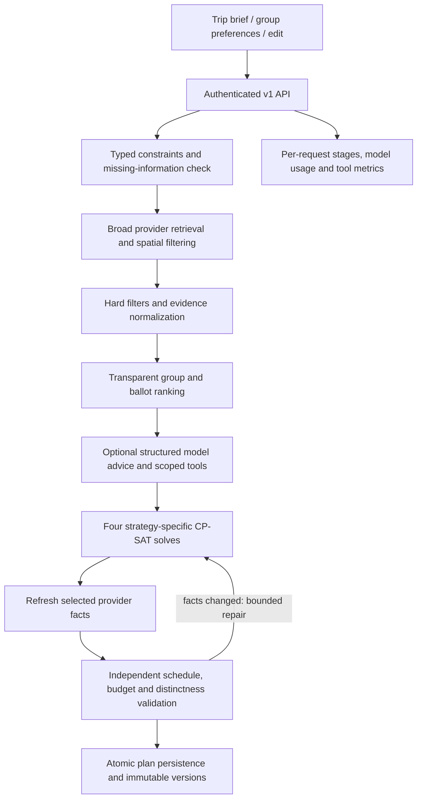

# TripPilot AI — Phase 2 implementation report

Phase 2 extends the existing FastAPI/React application with a staged planning engine, real CP-SAT scheduling, typed model/tool boundaries, group ballots, partial edits, immutable versions and reproducible evaluation. The application remains available at `http://localhost:5173`; API documentation is at `http://localhost:8000/docs`.

## Phase 1 audit and preservation

Before implementation, all 104 Phase 1 tests passed on SQLite and PostgreSQL. The source snapshot is `/private/tmp/trippilot-before-phase2.zip`; the [audit](phase2-audit.md) records the baseline and changes.

Migration `0012_ai_planning` adds policies, account-linked traveler preferences, place constraints, ballots, run/call telemetry and version snapshots. It preserves existing normalized itinerary tables. A separate copy of the original SQLite database was upgraded from 0009 to 0012: all original row counts were preserved, including 38 trips, 106 travelers, 144 plans and 514 conversation messages. Existing details backfilled 188 activities. The original SQLite file remained byte-for-byte unchanged. See [migration evidence](../artifacts/phase2-migration.json).

Compatibility APIs remain protected by the existing session/role checks. Trips without an advanced policy can use the legacy planner. Once advanced planning is enabled, compatibility generation routes use the constrained engine. Legacy detail mutation endpoints reject optimized plans when they would bypass schedule validation and versioning.

## Architecture and AI workflow



`backend/ai/pipeline.py` coordinates these stages. Each stage records its latency and success/failure. Provider failures and infeasible schedules preserve existing itineraries. Model failures use deterministic ranking. Persistence begins only after all four alternatives pass validation, and the trip version is rechecked under a lock before saving.

Candidate retrieval starts with up to 300 provider records, fills underrepresented categories, retrieves mandatory IDs and uses the existing PostGIS radius path when an anchor is specified. Hard filtering rejects unsupported costs, closure/age violations, incompatible or unverified required diets/accessibility, distance violations and, by default, unknown opening windows. Mandatory IDs, subcategories and category diversity survive ranked-pool trimming.

`backend/ai/replanning.py` extracts a single typed edit, identifies affected days, fixes the other days and their costs, and solves the affected portion. Removal of a category creates a day-specific veto. Cheaper-day edits impose a 10% lower activity ceiling; reduced-transfer edits impose a 25% lower transfer-minute ceiling. If these are infeasible, the existing plan remains intact. Successful edits keep unaffected day/activity rows, append a version and record the change. Rollback revalidates a historical schedule against current provider facts and appends another version.

## Ranking and group aggregation

All score components are visible in saved metadata and the UI. Default weights are configurable through `PlanningConstraints.ranking_weights`:

| Component | Default weight | Measurement |
|---|---:|---|
| Preference | 0.30 | Equal-weight mean of members' category/subcategory interests |
| Group fit | 0.20 | Minimum member interest for the candidate |
| Rating | 0.10 | Provider-sourced rating / 5; absent ratings contribute zero |
| Price fit | 0.10 | 1 − group candidate price / maximum eligible candidate price |
| Semantic relevance | 0.10 | Nonnegative similarity between free-text preferences and place metadata |
| Novelty | 0.05 | Unseen-candidate indicator; constant on the initial generation |
| Ballots | 0.10 | Normalized up/down votes and reciprocal-rank contributions |
| Time fit | 0.05 | Fraction of trip dates with usable opening windows |
| Distance | −0.10 | Anchor distance / maximum leg distance, capped at one |

The sum receives at most `0.05 × model relevance` as optional soft advice. Budget strategy triples price-fit weight; experience increases preference/novelty weights; relaxed triples the anchor-distance penalty. The model cannot change costs, coordinates, hours or hard constraints.

Each authenticated traveler can save interests, free text, a soft per-person/per-activity budget preference, diet/mobility requirements and must/veto IDs/categories. The group takes the union of hard requirements; a must-have/veto conflict returns an actionable error. Equal-weight preference means and minimum-member fit avoid granting the creator a special ranking advantage. A member's activity budget preference halves that candidate's personal preference score when exceeded; it does not replace the trip's hard budget ceiling.

Up/down/rank ballots are durable, account-scoped and trip-scoped. Plan ballots distribute influence to their activities; only current non-stale plans and current group members contribute. Existing group-selection votes also contribute. Membership revocation blocks access and excludes the account's ballots. Traveler profiles represent the traveling party and remain stored when account access is revoked.

The default semantic backend uses deterministic normalized, synonym-expanded hash vectors. It recognizes supported concepts such as quiet/calm, greenery/gardens and jazz/music. Optional SentenceTransformers initialization is lazy. Hard filters always use structured fields. These default vectors are not a trained semantic language model, and no MiniLM quality claim is made.

## Optimization objective and budget enforcement

OR-Tools 9.15 CP-SAT jointly chooses places, assigns days and orders visits. The model uses binary selections, optional intervals, no-overlap constraints, a directed daily circuit, opening-window choices, travel precedences, duration, return time, mandatory inclusion and integer-cent budget ceilings. Each place is used at most once across the trip. A prior activity-set exclusion makes the four generated sets distinct.

For selected candidate `i`, the utility coefficient is:

```text
u_i = int((rank_score_i + 0.25) × 1000)
      − strategy_cost_penalty × round(100 × cost_i / max_candidate_cost)

maximize 10000 × (Σ u_i × selected_i − travel_penalty × route_minutes)
         − Σ selected_start_minutes
```

The start-time term favors earlier feasible starts. It is part of the weighted objective, not a separate proof of globally shortest routes.

| Strategy | Maximum stops/day | Travel penalty | Cost penalty |
|---|---:|---:|---:|
| Balanced | 3 | 5 | 1 |
| Budget | 3 | 7 | 8 |
| Experience | 4 | 3 | 0 |
| Relaxed | 2 | 14 | 1 |

Every day includes one priced dinner at/after 17:00; nightlife starts at/after 18:00. Inter-activity breaks are 10 minutes, or 20 for relaxed plans. Geographic coherence comes from joint assignment and route penalties, maximum leg distance and daily transfer limits. PostGIS supports anchored candidate filtering; schedule travel uses explicit coordinate/speed estimates, not live road/transit traffic. An anchor adds departure and return travel. Without an anchor, return-by means the final activity deadline.

The independent validator recomputes route estimates, timing, windows, duration, uniqueness, daily meals/stops, must/veto requirements, return legs, walking/transfer ceilings and daily/total costs. Only `FEASIBLE` or `OPTIMAL` solver results passing validation can be saved. The default solve limit is three seconds per attempt, one worker and a fixed seed; larger candidate/date combinations can hit the limit.

Fixed transportation, hotel, breakfast/lunch, local-transport and miscellaneous costs are reserved before activity selection. Unknown essential costs require an explicit user allowance or provider data. Provider activity prices are not rescaled to fit a budget. Selected facts are refreshed after solving; price/hour changes trigger up to three total solve attempts. Value-tier non-activity estimates can repair an excessive fixed-cost allocation. Remaining infeasibility is reported, not saved as an over-budget itinerary. Costs remain estimates, including when the arithmetic is exact.

Explanations use stored score components, strategy settings, evidence and calculated differences relative to balanced. Quantitative savings are derived from actual plan totals. Naming and factual-answer rendering use controlled templates; models choose typed evidence/label options rather than supplying factual prose.

## Tools and model abstraction

`LLMProvider.complete` returns a normalized reply, native calls, continuation items and reported token usage. `OllamaProvider` uses local chat/tool APIs; `OpenAIProvider` uses Responses with strict JSON schemas, `store=False`, and request-local continuations. Model names remain configuration values. No remote conversation ID is shared between trips.

The service validates outputs with Pydantic, performs at most two configured correction attempts, and permits at most two tool rounds with four calls each. Ollama tool selection uses native argument schemas; final-answer JSON is validated and corrected with the response schema. Its final grammar is not imposed on the native tool-call token stream. OpenAI retains the native strict schema path. Provider descriptions are treated as data, tool arguments are validated, and unsupported IDs are rejected.

| Exposed tool | Actual implementation |
|---|---|
| `search_places` | Current trip's retrieved, filtered candidate records |
| `get_place_details` | Existing candidate evidence snapshot |
| `get_route` | Labeled coordinate distance/time estimate between known IDs |
| `get_flight_options` | Existing configured flight-provider adapter |
| `convert_currency` | Existing exchange-rate service into trip currency |
| `calculate_budget` | Integer/Decimal totals including reserved costs |
| `optimize_schedule` | Real CP-SAT optimizer with trip constraints |

No placeholder hotel/event search tool is exposed. Tools cannot accept arbitrary URLs, SQL or another trip's identifier. Their failures return sanitized errors. Native tool outputs are sent back to the same model request sequence.

## API, storage and scope

All paths below are under `/api/v1`:

| Endpoint | Purpose / permission |
|---|---|
| `GET/PUT /trips/{id}/ai/constraints` | Read for members; change for owner/editor |
| `GET/PUT /trips/{id}/ai/preferences/me` | Current member's own traveler profile |
| `GET/PUT /trips/{id}/ai/votes` | Member ballots; only own ballot is changed |
| `DELETE /trips/{id}/ai/votes/{ballot_id}` | Delete own ballot |
| `POST /trips/{id}/ai/generate` | Owner/editor; optional model assistance |
| `POST /itineraries/{id}/replan` | Owner/editor; expected version required |
| `GET /itineraries/{id}/versions` | Member-readable version metadata |
| `POST /itineraries/{id}/rollback` | Owner/editor; expected/target version required |
| `GET /trips/{id}/ai/runs[/{run_id}]` | Owner-only stage and model-call diagnostics |

Normalized day/activity/cost rows remain the operational schedule. Immutable `ItineraryVersion` snapshots record complete historical evidence and schedules. `PlanningPolicy`, `TravelerPlaceConstraint` and `PlanningBallot` persist explicit group data. `PlanningRun` and `LLMCall` persist stage latency, model/provider, purpose, usage and outcomes. Trip and itinerary versions prevent lost updates and stale edits. Preferences and edits remain scoped to their trip; model continuations are local to one call sequence.

Usage totals come from provider response fields. Missing token data is marked incomplete; missing pricing rates yield unknown estimated cost. Diagnostic metrics include received/valid structured responses, checked/unsupported IDs, native tool results and fallback use. Unsupported-reference rate concerns model-proposed place IDs, not a general hallucination estimate. Final provider-reference grounding measures correspondence to supplied evidence, not whether that provider's real-world data is correct.

## Verification and actual metrics

The baseline 104 tests expanded to 136 tests covering structured output correction, model adapters, native tool routing, hard filters, ranking and semantic concepts, account permissions and ballots, CP-SAT timing/geography/budgets, provider refresh repair, failure preservation, partial edits and rollback. The final full suites passed: **136 tests on SQLite in 16.63s and 136 on PostgreSQL in 14.25s**. Ruff lint and formatting checks passed for all 156 Python files. The only test warning is the existing Starlette TestClient/httpx deprecation.

Evaluation uses newly created temporary databases and synthetic provider facts. Its six scenarios cover budget NYC, family restrictions, nightlife, accessibility/diet, conflicting member interests and an impossible budget. Five successful scenarios yield 20 plans; the sixth must reject. Tests separately verify more detailed hard-filter rules. Geographic efficiency compares each chosen route with nearest-neighbor ordering for the same chosen places and starting point; it is not a global routing optimum comparison.

Results recorded 2026-10-26T22:45:01.038123+00:00 and 2026-10-27T15:03:42.433927+00:00 (UTC):

| Metric | Deterministic run | Local Ollama `qwen3:1.7b` |
|---|---:|---:|
| Scenarios passing | 6/6 | 6/6 |
| Plans evaluated | 20 | 20 |
| Measured hard-check satisfaction | 100.00% | 100.00% |
| Budget compliance | 100.00% | 100.00% |
| Schedule validity | 100.00% | 100.00% |
| Provider-reference grounding | 100.00% | 100.00% |
| Mean preference-category coverage | 86.67% | 86.67% |
| Structured response validity | Not measured | 55.56% |
| Unsupported ID rate | Not measured | 0.00% |
| Model calls, including rejected requests | 0 | 9 |
| Input tokens | 0 | 15007 |
| Output tokens | 0 | 919 |
| Native tools executed | 0 | 10 |
| Requests using deterministic fallback | 0 | 4 |
| Native tool success rate | Not measured | 100.00% |
| Median request latency, all six scenarios | 874.39 ms | 3908.73 ms |
| Configured token-cost estimate (USD) | 0 | 0.0 |

Deterministic: successful-generation median 902.52 ms; mean route/nearest-neighbor ratio 1.0090, maximum 1.1048. Model-assisted: successful-generation median 3472.56 ms; mean route/nearest-neighbor ratio 1.0090, maximum 1.1048. 

The final local-model run executed 10 native tools successfully. Four requests used deterministic fallback when the bounded model interaction did not produce an acceptable final result. No unsupported IDs were accepted. Structured validity counts accepted native-call envelopes or schema-valid final responses divided by received responses; provider errors are excluded and tool execution success is measured separately.

Raw evidence: [deterministic benchmark](../artifacts/phase2-evaluation.json), [real local-model benchmark](../artifacts/phase2-evaluation-ollama.json), [dedicated native-tool smoke](../artifacts/phase2-native-tools-smoke.json), and [Docker HTTP integration](../artifacts/phase2-stack-smoke.json). The native-tool smoke separately recorded one executed search, 2,948 input tokens and 327 output tokens with one bounded correction; its local token-cost estimate was zero.


The OpenAI adapter is implemented but has not been exercised against a paid live OpenAI endpoint. A real local Qwen run and native tool smoke check are separate from scripted unit tests. Zero local token pricing means no API charge and excludes electricity/hardware costs. Latencies are single local runs, affected by concurrent tests and model loading; they are not production percentiles or a controlled speed comparison.

Frontend TypeScript/Vite production builds pass. Docker images include OR-Tools; nginx-to-API-to-PostgreSQL smoke checks cover authentication, preferences, four distinct schedules, selection, votes/rank, preserved-day edits, rollback, diagnostics and logout. This is HTTP integration verification, not automated browser interaction or a visual accessibility audit. The normal Docker application database is restored after isolated testing.

## Files changed

The complete source inventory relative to the pre-Phase-2 snapshot is in [phase2-files.json](../artifacts/phase2-files.json). Main implementation groups:

| Files | Changes |
|---|---|
| `backend/ai/{schemas,pipeline,constraints,retrieval,ranking,group,optimizer,budget,tools,replanning,persistence}.py` | Typed planning stages, group ranking, CP-SAT, tools, edits and versions |
| `backend/llm/{providers,service,telemetry,answers}.py` | Shared model boundary, validation/correction, tracing and factual answer selection |
| `backend/api/ai.py`, `backend/api/{v1,legacy}.py`, `backend/main.py` | New authenticated APIs and compatibility integration |
| `backend/models.py`, `migrations/versions/0012_ai_planning.py` | Persistent policies, preferences, ballots, versions and telemetry |
| `backend/{planning,settings}.py`, `backend/core/auth.py`, `backend/domain/{trips,itineraries}.py` | Protected compatibility, configuration, owner profiles and versioned renames |
| `backend/orchestration/{parser,service}.py`, `backend/naming/plan_name_generator.py` | Structured extraction/answers/naming and request usage tracking |
| `backend/embeddings/preference_encoder.py`, `backend/providers/seed.py` | Concept vectors and explicitly synthetic demo hours |
| `frontend/src/{AdvancedPlanner.tsx,advanced.css,main.tsx}` | Advanced planning, voting, edits, history and diagnostics UI |
| `backend/evaluation/`, `scripts/evaluate_planning.py`, `tests/test_phase2_*.py`, `tests/phase2_fixtures.py` | Reproducible benchmarks and regressions |
| `requirements.txt`, `.env.example`, `docker-compose.yml`, `.github/workflows/ci.yml`, `README.md` | Dependencies, deployment settings, evaluation artifact CI and documentation |

## Known limitations

- Provider grounding prevents model invention; it does not guarantee live price accuracy, venue availability, reservation inventory or source freshness. Demo fixtures are clearly labeled and must not be treated as travel advice.
- The hours parser intentionally supports a bounded subset of opening-hours syntax. Unsupported syntax is unknown; holidays/exception dates require provider data. Disabling required known hours explicitly permits unverified windows.
- Distances/travel minutes are coordinate estimates. Real walking paths, stairs, traffic, transit schedules and physical accessibility along a route are not verified. “Reduce walking” currently lowers transfer minutes; mixed-mode transfer minutes are not measured walking minutes.
- The current schedule is activity/dinner oriented. It has one dinner per day, unique places across days and fixed maximum stop counts. It does not jointly optimize bookable hotel inventory, flights, events or lunch reservations. Too few eligible meals, mandatory activities or distinct alternatives may make all-four generation infeasible.
- `FEASIBLE` does not mean optimal. Candidate trimming and solver limits bound work; required IDs/subcategories and category diversity can grow the retained pool above its nominal cap. Large trips need operational limits/benchmarking before production scale.
- The minimum-member score promotes fairness but does not guarantee an equal realized satisfaction score for every traveler. Novelty is currently a constant fresh-candidate prior unless an explicit seen set is supplied to the ranking function.
- Soft budget preference and many advanced mandatory/anchor/day-specific controls are exposed through the API; the UI exposes the common preferences, schedule/cost limits, voting and edit flows. Trip-wide constraint changes require regeneration.
- Native tools are actually executed, but model choice controls whether the model requests them. Invalid advice can trigger deterministic fallback. Model usage from failed planning requests is included in benchmark totals.
- OpenAI production credentials, optional trained embeddings, live provider quality and automated browser interaction were not verified in this phase. CI configuration was updated; no hosted CI run is claimed.
- The original SQLite data remains separate from PostgreSQL. No legacy ownership assignment or cross-database import was performed. Membership changes preserve traveler preferences as party data.

## Implementation references

Native tool adapters follow the [OpenAI function calling documentation](https://developers.openai.com/api/docs/guides/function-calling) and [Ollama tool calling](https://docs.ollama.com/capabilities/tool-calling) / [structured outputs](https://docs.ollama.com/capabilities/structured-outputs) interfaces. The scheduling model uses the official [OR-Tools CP-SAT solver](https://developers.google.com/optimization/cp/cp_solver) and [scheduling examples](https://github.com/google/or-tools/blob/stable/ortools/sat/docs/scheduling.md).
